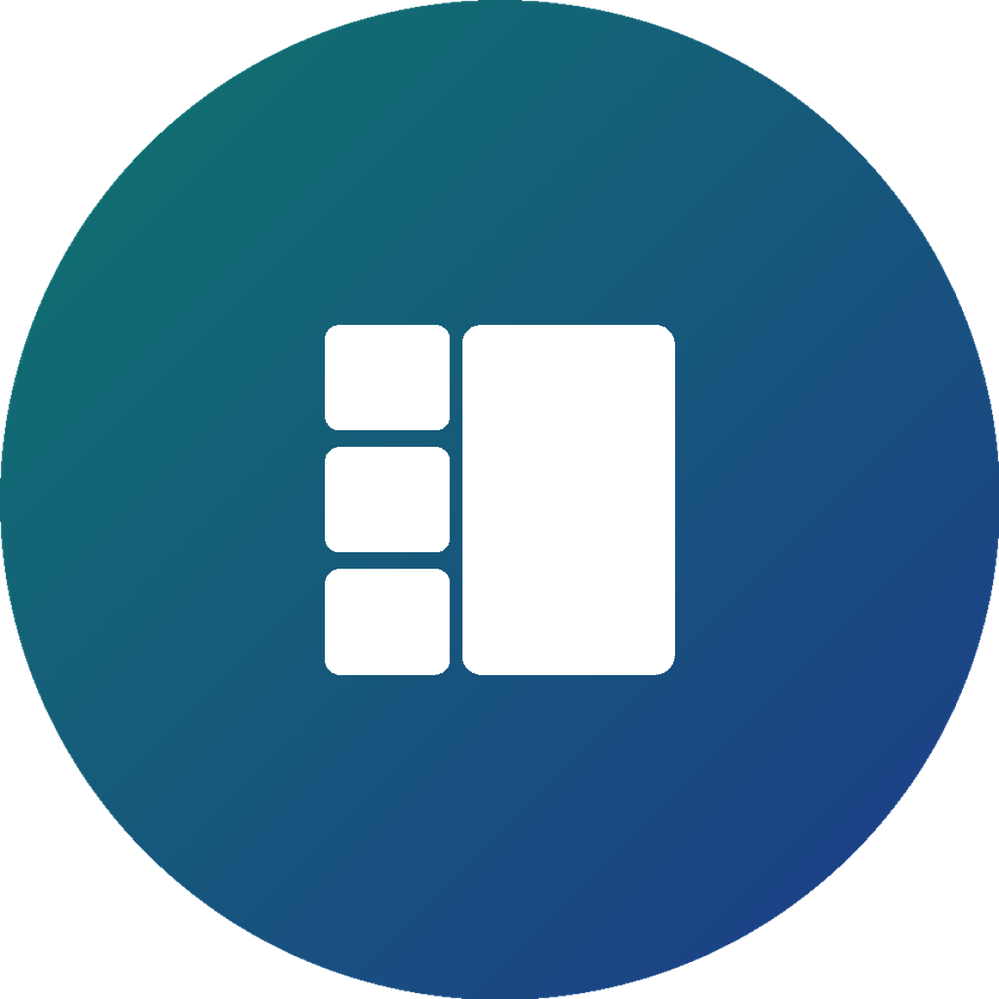

  

<h2 align="center">PaneDeck</h2>

ColorOS 侧边工作台，一键比价。 基于 <a href="https://github.com/lujinxin/NeXtep">lujinxin 的 NeXtep</a> 的 LSPosed 模块（Apache-2.0）。

  <a href="README.md">English</a>

## 是什么

PaneDeck 给 ColorOS 16 / 17 加一个 OneStep 风格的侧边工作台，保留原装桌面。一个主窗口加三个实时小窗，拖动换窗——点放大镜输一次关键词，同时在几个购物或外卖应用里搜，每个结果各占一窗，当场比价。

**当前版本：1.0.0。**安装包见 [GitHub Releases](https://github.com/JHeyzo/PaneDeck/releases)。

## 功能

- **侧边工作台：**一个主窗口加三个实时小窗，拖动交换，从后台卡片或应用栏添加。
- **一键比价：**输一次，购物搜京东 / 淘宝 / 拼多多 / 抖音商城，外卖搜京东外卖 / 淘宝闪购 / 美团。不爬价格、不下单，各应用打开自己的搜索页。
- **手势：**底角上滑、双指上下滑打开，上滑退出，各有独立开关。
- **圆角：**主窗 16dp、小窗 12dp（可切直角）。
- **控制中心磁贴、媒体控制、自定义文字、深色启动图标。**

## 要求

- 一加 PLK110，ColorOS 16 / 17（Android 16 / 17），其他机型需单独适配。
- KernelSU（或同类 root）+ Zygisk + LSPosed。

## 安装

1. 从 [Releases](https://github.com/JHeyzo/PaneDeck/releases) 下载安装包安装。
2. 在 LSPosed 里给 PaneDeck 勾上作用域列表里的全部包。
3. 重启手机。进 PaneDeck 设置添加控制中心磁贴。

## 署名

基于 **lujinxin 的 NeXtep 2.1.0**（Apache License 2.0）。上游项目版权属于 lujinxin；PaneDeck 的修改部分版权属于 JHeyzo。见 [THIRD_PARTY_NOTICES.md](THIRD_PARTY_NOTICES.md)。

## 许可证

[Apache License 2.0](LICENSE)。
